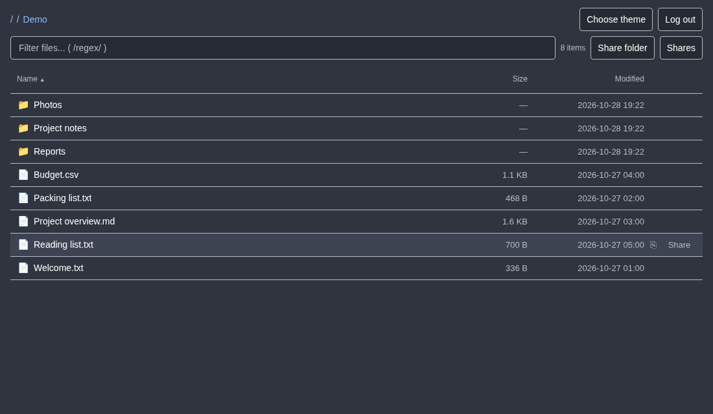
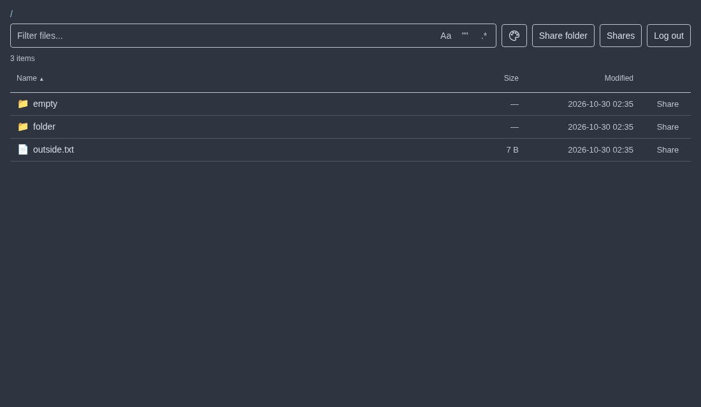

# Go file-share

A self-hosted file browser for sharing files and folders through expiring links. Browse your files, create a link, and let recipients download without an account.

The browser interface and database are built in. There are no uploads or multi-user accounts.

## Features

- **Browse:** Navigate folders, [filter filenames](docs/usage.md#browse-files) with always-visible inline case, phrase, or regex toggles, and sort by name, size, or modification time.
- **Share:** Create recipient file or folder links with an expiry or no time limit; owner-only copy links are labeled separately. View and revoke links from the Shares panel.
- **Download:** Download files with HTTP range support for seeking and resuming in compatible clients.
- **Customize:** Choose Light, Nord, Catppuccin Mocha, Rose Pine, or Rose Pine Dawn; one browser cookie shares your choice across owner and shared-folder pages on the same host.
- **Navigate:** Use keyboard controls and a layout that adapts to smaller screens.

Watch the sharing demo

*Recorded with synthetic files. Close this section to hide the animation, or follow the [usage guide](docs/usage.md) without motion.*

Folder links include new files added to the shared folder. Shared paths are live references: trusted filesystem writers can replace or retarget them. Relative symlinks work within the applicable folder or file-parent boundary; absolute and escaping links are rejected. See [filesystem boundaries](SECURITY.md#filesystem-boundaries). Revoking a link stops new requests; downloads already underway may finish.

## Requirements

- Linux for the supported runtime, packages, and installation guides. Windows is not supported or tested.
- A reverse proxy providing HTTPS.
- Read access to your files and writable storage for the database.

The application runs as a single binary with no external database server or runtime asset downloads. Browser access uses one owner account; recipients use shared links.

## Installation

**Docker Compose with a published image is the recommended starting point.** The root [`compose.yaml`](compose.yaml) matches the [installation guide](docs/compose.md): pull-only images, public Caddy HTTPS/HTTP/3, and explicit `-origin` configuration. Prepare credentials and writable state before starting.

| Method | Guide |
|---|---|
| Docker Compose | [Install with Compose](docs/compose.md) |
| Linux binary with systemd | [Install with systemd](docs/systemd.md) |
| Build from source | [Build and run with Go](docs/source.md) |
| Nix package | [Build and run with Nix](docs/nix.md) |
| NixOS service | [Configure the NixOS module](docs/nixos.md) |

## Documentation

- [Usage](docs/usage.md) — browsing, sharing, keyboard controls, and themes.
- [Configuration](docs/configuration.md) — settings, defaults, and credentials.
- [Operations](docs/operations.md) — updates, backups, recovery, and troubleshooting.
- [Security](SECURITY.md) — security boundaries and deployment hardening.
- [Contributing](CONTRIBUTING.md) — development and testing.
- [Release notes](RELEASE_NOTES.md) — version changes and upgrade information.
- [Release procedures](docs/releases.md) — local packaging and publication, with shared strict version validation.

## License

[MIT](LICENSE). Third-party components retain their [respective licenses and notices](THIRD_PARTY_NOTICES.md).
